<div align="center">

# Studium Autopilot – EcoBA

**Dein EcoBA-Studium an der Uni Tübingen an einem Ort.**<br>
Termine und Fristen, die sich selbst aktualisieren, Stundenplan, Module, Noten und ECTS, Unterlagen und Karteikarten –
in der kostenlosen App Obsidian, auf iPhone, iPad, Android, Mac und Windows.

<a href="https://github.com/studium-autopilot/ecoba/releases/latest"></a>
<a href="https://github.com/studium-autopilot/ecoba/actions/workflows/pruefen.yml"></a>
<a href="LICENSE"></a>


<sub>🇬🇧 <a href="#in-english">English summary</a></sub>

<br>

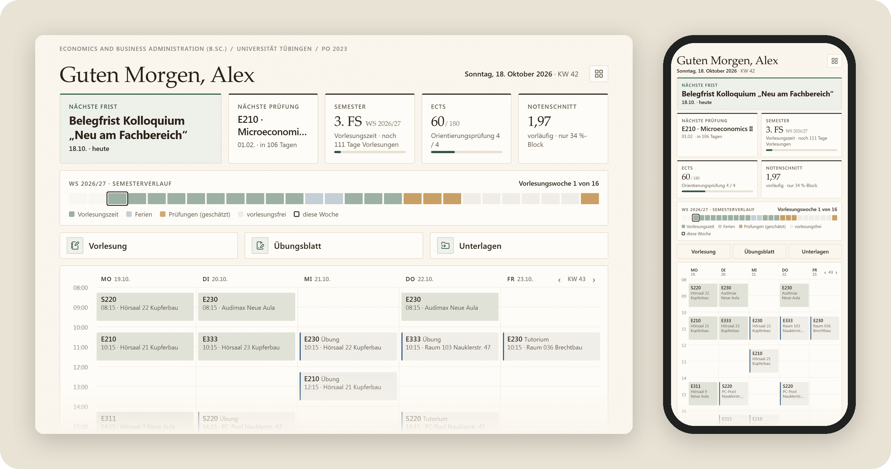

Für Studierende im B.Sc. Economics and Business Administration (PO 2023). Kein Konto, keine Kosten, keine Werbung.

</div>

<div align="center">

## In 3 Schritten starten

<br>

<br>
<b>Obsidian installieren</b>

<a href="https://apps.apple.com/app/obsidian-connected-notes/id1557175442"></a>&nbsp;&nbsp;<a href="https://play.google.com/store/apps/details?id=md.obsidian"></a>&nbsp;&nbsp;<a href="https://obsidian.md/download"></a>

<br>

<br>
<b>Vorlage laden</b>

<a href="https://github.com/studium-autopilot/ecoba/raw/main/docs/kurzbefehl/Studium%20Autopilot%20installieren.shortcut"></a>&nbsp;&nbsp;<a href="https://github.com/studium-autopilot/ecoba/releases/latest/download/Studium-Autopilot.zip"></a>

<br>

<br>
<b>In Obsidian öffnen</b>

Ordner <b>Studium Autopilot</b> in Obsidian öffnen → <b>Dem Ersteller vertrauen und Erweiterungen aktivieren</b>. Fertig.

<br>

Eine kurze Einrichtung fragt nach Studienbeginn und Variante, jeder Schritt lässt sich überspringen.<br>
Mehrere Geräte? → [Weiteres Gerät verbinden](docs/installation.md#weiteres-gerät-verbinden) · Hängt es irgendwo? → [Hilfe zur Installation](#hilfe-zur-installation)

</div>

## Was drin ist

<table>
<tr>
<td width="50%" align="center" valign="top">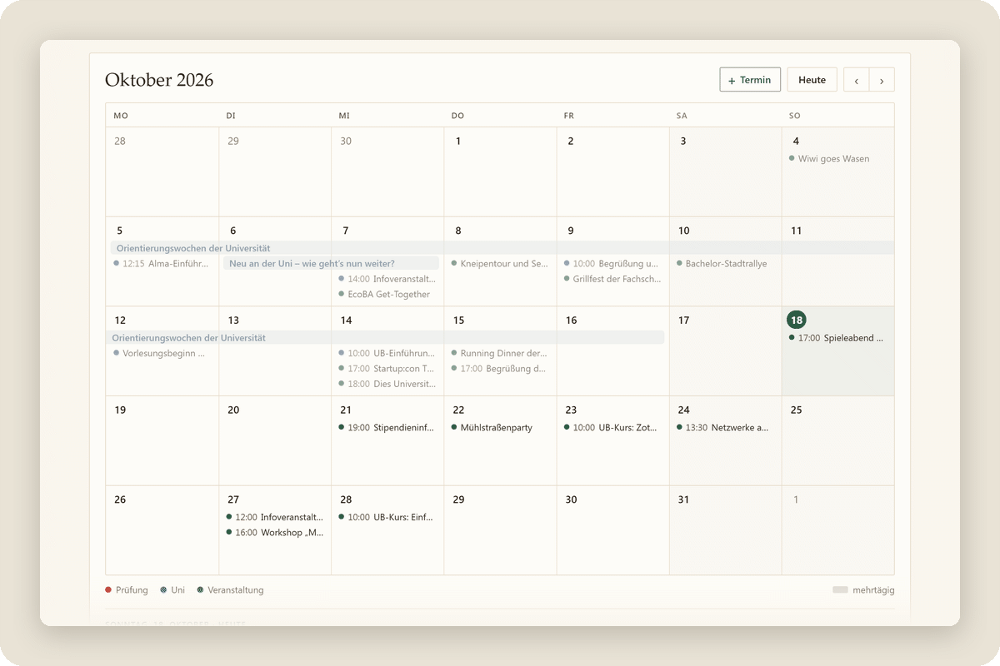<br><b>Kalender</b><br>Monat für Monat, mit Uni-Terminen, Fachschaft und mehrtägigen Zeiträumen; eigene Termine mit <b>+ Termin</b></td>
<td width="50%" align="center" valign="top">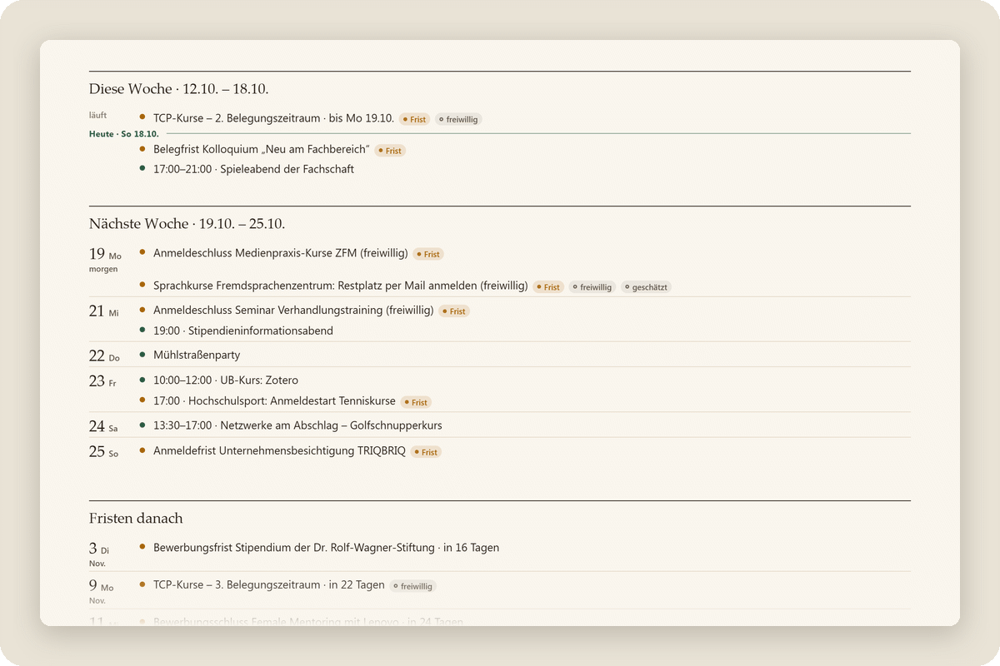<br><b>Termine & Anmeldungen</b><br>Woche für Woche: Fristen, Anmeldungen und Angebote der Uni wie Hochschulsport und UB-Kurse</td>
</tr>
<tr>
<td width="50%" align="center" valign="top"><br><b>Stundenplan</b><br>Deine Woche aus Alma mit Vorlesungen, Übungen und Tutorien, mit ‹ › durch alle Wochen</td>
<td width="50%" align="center" valign="top">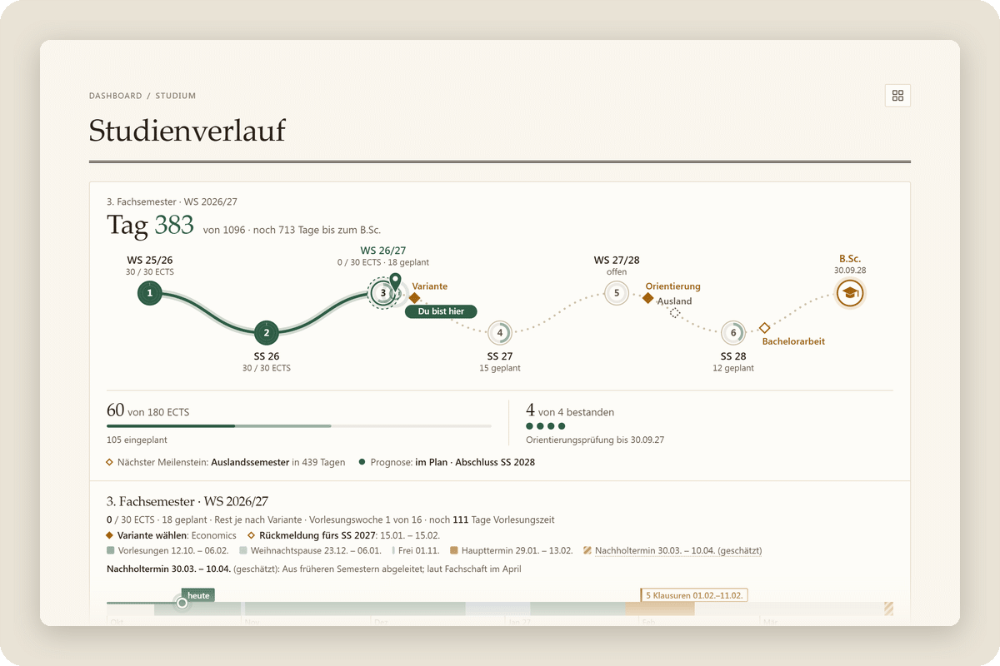<br><b>Studienverlauf</b><br>Semester bis zum Abschluss, Orientierungsprüfung, Schwerpunkte nach den Regeln der PO</td>
</tr>
<tr>
<td width="50%" align="center" valign="top">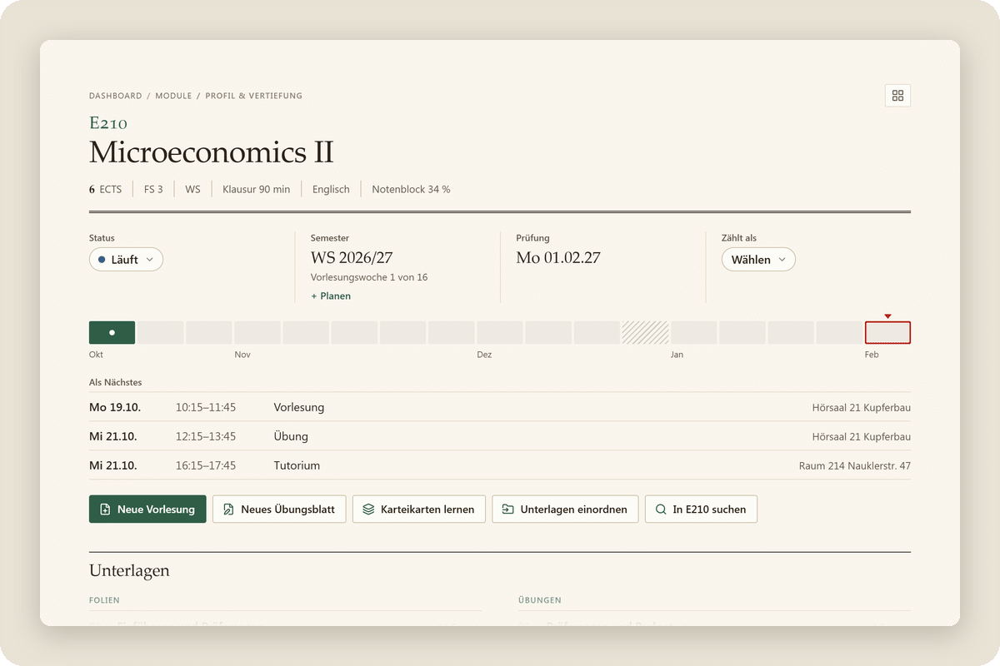<br><b>Modulseiten</b><br>Dein Stand, die Prüfung, deine Woche im Semester und was als Nächstes ansteht</td>
<td width="50%" align="center" valign="top">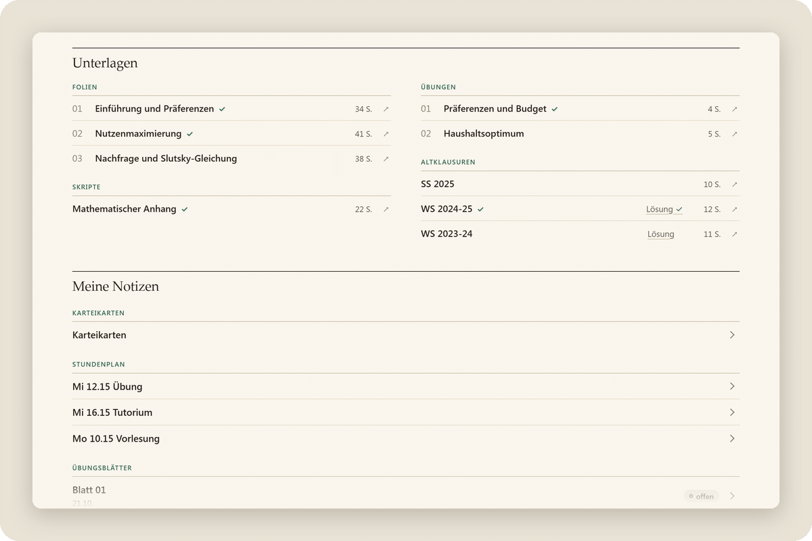<br><b>Unterlagen</b><br>Kursdateien aus ILIAS je Modul, nach Art sortiert, die Lösung neben ihrer Klausur</td>
</tr>
<tr>
<td width="50%" align="center" valign="top">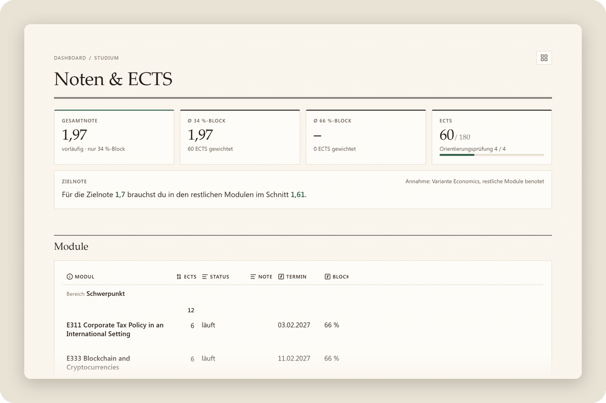<br><b>Noten & ECTS</b><br>86 Module nach PO 2023, Gesamtnote, ECTS und Zielnote rechnen sich selbst</td>
<td width="50%" align="center" valign="top">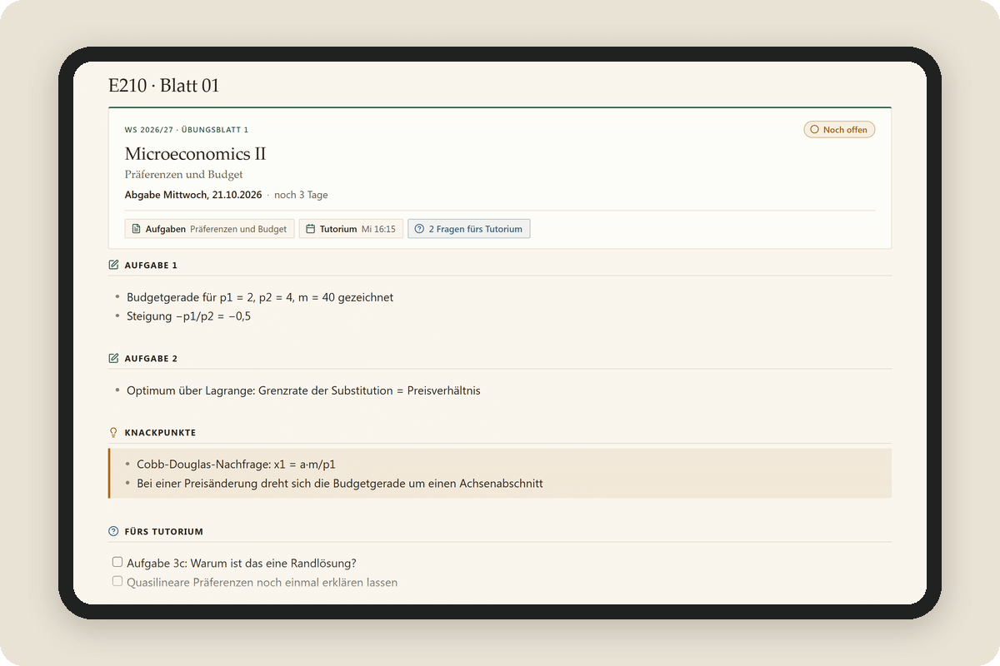<br><b>Übungsblätter</b><br>Abgabe, Status und deine Fragen fürs Tutorium auf einen Blick</td>
</tr>
<tr>
<td width="50%" align="center" valign="top">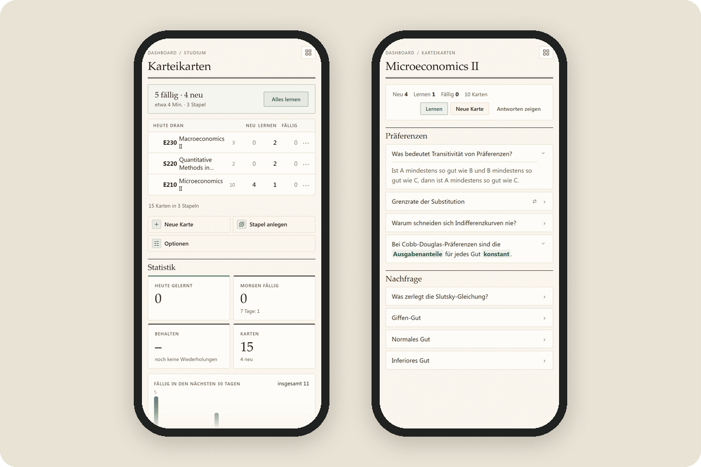<br><b>Karteikarten</b><br>Stapel je Modul, gelernt wird direkt in Obsidian, geplant mit dem Verfahren aus Anki</td>
<td width="50%" align="center" valign="top">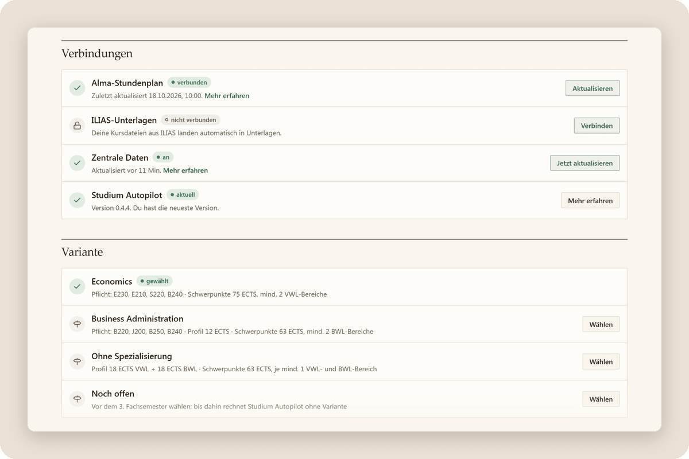<br><b>Einstellungen & Hilfe</b><br>Jede Verbindung sagt in einem Satz, wie es steht; hier wählst du auch Variante und Design</td>
</tr>
</table>

<p align="center">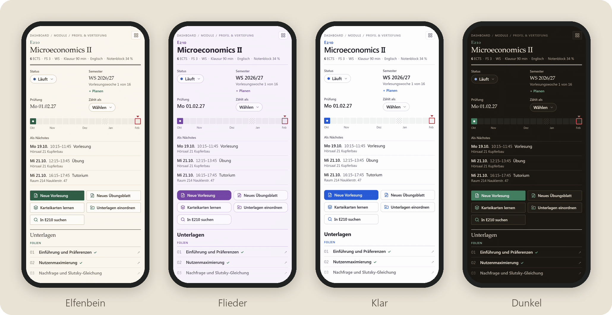<br><b>Drei Designs, hell und dunkel</b><br>Elfenbein, Flieder oder Klar, dazu ein Dunkelmodus. Jedes Gerät wählt für sich.</p>

## Woher die Daten kommen

Termine, Fristen und Semesterdaten pflegt nicht jede:r selbst. Ein Server prüft alle 15 Minuten öffentliche Quellen der Uni
(Seiten der Universität, des Prüfungsamts und der Fachschaft, öffentliche Kalender und PDFs) auf Änderungen. Nur wenn sich
etwas geändert hat, gleicht eine KI die Angaben ab. Vor dem Veröffentlichen wird jeder geänderte Eintrag automatisch geprüft:

- **Freigabeliste:** Nur bestimmte Arten von Terminen aus öffentlichen Quellen und nur bestimmte Felder gehen raus, nie Notiztexte.
- **Scan auf persönliche Daten:** Namen, Mailadressen, Telefonnummern und Ähnliches halten einen Eintrag zurück.
- **KI-Prüfung:** Ein zweiter, getrennter KI-Aufruf prüft geänderte Einträge auf persönliche Angaben und Plausibilität.

Nur was alle Prüfungen besteht, landet als einfache Datendatei im öffentlichen Repo
[`studium-autopilot/ecoba-daten`](https://github.com/studium-autopilot/ecoba-daten). Das Plugin im Tresor holt sie dort ab,
prüft sie noch einmal und legt daraus Termin-Notizen an.

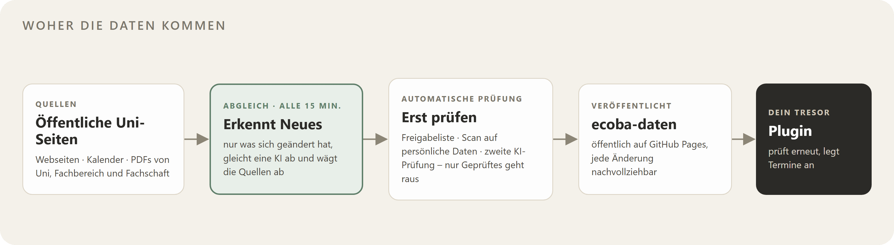

Die KI kann sich irren. Darum steht an jedem Termin die Quelle und das Datum der letzten Prüfung; Angaben, die die Uni noch
nicht veröffentlicht hat, sind als **geschätzt** markiert. Der Code des Abgleichs ist nicht Teil dieses Repos. Das
Datenformat steht in [docs/daten-v1.md](docs/daten-v1.md).

## Datenschutz: Was das Plugin tut und nicht tut

Der Tresor bringt ein eigenes kleines Plugin mit („Studium Autopilot“). Du musst nichts weiter installieren.

- **Lädt von selbst nur Daten, nie Code.** Eine neue Version kommt nur, wenn du auf **Aktualisieren** tippst – direkt aus
  diesem Repo, jede Datei mit Prüfsumme geprüft, vorher mit Sicherung. Deine Einträge bleiben.
- **Kein Konto, keine Statistik, keine Telemetrie.** Nichts über dich geht an den Autor oder an Dritte. GitHub sieht beim
  Abruf deine IP-Adresse, wie bei jeder Webseite.
- **ILIAS nur, wenn du es verbindest.** Dann meldet sich das Plugin von deinem Gerät aus bei der Uni an und lädt deine
  Kursdateien, nur von den Servern der Uni. Das Passwort liegt verschlüsselt im Schlüsselbund von Obsidian auf diesem Gerät
  und wird nie synchronisiert.
- **Dein Alma-Link bleibt auf dem Gerät.** Er wird nicht synchronisiert und nirgends hin geschickt.
- **Deine Einträge bleiben deine.** Häkchen und „Meine Notizen“ in einem Termin überschreibt der Abruf nie, Noten und
  Status deiner Module bleiben auch bei einem Update.

Mehr dazu: [docs/datenschutz.md](docs/datenschutz.md).

## Hinweis

**Kein offizielles Angebot der Universität Tübingen. Keine Gewähr – maßgeblich sind Alma, Prüfungsamt und
Prüfungsordnung.** Studium Autopilot ist eine Beta und wird laufend erweitert; neue Versionen kommen mit einem Tipp auf
**Aktualisieren**.

Der Tresor enthält keine Lehrmaterialien (Folien, Skripte, Altklausuren); Dateien aus ILIAS lädt das Plugin nur für dich in
deinen eigenen Tresor. Modul- und Prüfungsordnungs-Angaben sind in eigenen Worten zusammengefasst und auf die öffentlichen
Dokumente der Universität verlinkt. Die Bilder zeigen einen Beispiel-Tresor mit erfundenem Namen, Noten, Stundenplan und
Unterlagen.

Apple und App Store sind Marken der Apple Inc. Google Play und das Google Play-Logo sind Marken der Google LLC.

## Fehler melden

Termin falsch, Frist fehlt oder etwas sieht kaputt aus? Bitte ein
[Issue](https://github.com/studium-autopilot/ecoba/issues/new/choose) öffnen – es gibt Vorlagen für Fehler, Termine und
Ideen. Sicherheitslücken bitte privat melden: [SECURITY.md](SECURITY.md). Änderungen je Version:
[CHANGELOG.md](CHANGELOG.md), alle Versionen: [Releases](https://github.com/studium-autopilot/ecoba/releases).

## Hilfe zur Installation

<details>
<summary><b>Hilfe für iPhone & iPad</b></summary>

1. **Obsidian** einmal öffnen und wieder schließen.
2. [**Kurzbefehl für iPhone & iPad**](https://github.com/studium-autopilot/ecoba/raw/main/docs/kurzbefehl/Studium%20Autopilot%20installieren.shortcut) antippen → **Laden** → Datei öffnen → **Kurzbefehl hinzufügen**.
3. Den Kurzbefehl starten → **Erlauben** → als Ort **iCloud Drive → Obsidian** wählen (kein iCloud: **Auf meinem iPhone → Obsidian**).
4. Obsidian öffnen → **Studium Autopilot** → **Dem Ersteller vertrauen und Erweiterungen aktivieren**.

Klappt der Kurzbefehl nicht: [ZIP-Datei](https://github.com/studium-autopilot/ecoba/releases/latest/download/Studium-Autopilot.zip) laden, in **Dateien** antippen und den Ordner nach **iCloud Drive → Obsidian** (kein iCloud: **Auf meinem iPhone → Obsidian**) bewegen.

</details>

<details>
<summary><b>Hilfe für Mac & Windows</b></summary>

1. [ZIP-Datei](https://github.com/studium-autopilot/ecoba/releases/latest/download/Studium-Autopilot.zip) laden und entpacken (Mac: Doppelklick, Windows: Rechtsklick → **Alle extrahieren**).
2. Den Ordner `Studium Autopilot` an einen festen Platz legen, z. B. **Dokumente**.
3. Obsidian öffnen → **Ordner als Vault öffnen** → den Ordner `Studium Autopilot` wählen.
4. **Dem Ersteller vertrauen und Erweiterungen aktivieren**.

</details>

<details>
<summary><b>Hilfe für Android</b></summary>

1. [ZIP-Datei](https://github.com/studium-autopilot/ecoba/releases/latest/download/Studium-Autopilot.zip) laden, in **Dateien** antippen → **Entpacken**.
2. Obsidian öffnen → **Ordner als Vault öffnen** → den Ordner `Studium Autopilot` wählen → Zugriff **Erlauben**.
3. **Dem Ersteller vertrauen und Erweiterungen aktivieren**.

</details>

Die ganze Anleitung mit Alma, ILIAS, weiteren Geräten und Updates: [docs/installation.md](docs/installation.md).

## Wie es gebaut ist

Für alle, die den Code lesen oder mitarbeiten wollen.

- **Plugin ohne Build-Schritt:** Ein kleiner, handgeschriebener Kern (`main.js`) lädt die Skripte aus `System/Skripte/` im
  Tresor und lädt sie bei jeder Änderung neu. Tabellen sind Obsidian Bases, das Aussehen sind CSS-Snippets.
- **Läuft auf iPhone und iPad:** keine Node-APIs in Skripten, eigene Regeln für Skript-Autoren, eine Prüfung gegen Safari 16.
- **Zentrale Daten mit Vertrag:** versioniertes JSON mit Prüfsummen; das Plugin prüft jede Datei, bevor es etwas schreibt.
- **Update mit einem Tipp:** Update-Liste mit SHA-256 je Datei, geladen vom unveränderlichen Tag der Version, vorher eine
  Sicherung.
- **ILIAS direkt vom Gerät:** Anmeldung über das Single Sign-on der Uni, Seiten lesen nach dem Vorbild von PFERD.
- **Geprüft bei jedem Push:** Node-Tests ohne Obsidian, ESLint, Ruff und ein Datenschutz-Scan in GitHub Actions.

```
npm ci
npm test          # Tests ohne Obsidian (Node 22 oder neuer)
npm run lint      # ESLint
npm run pruefen   # Dateitypen, Datenschutz-Scan, Regeln für iPhone und iPad
```

Mehr: [Architektur](docs/architektur.md) · [Datenformat](docs/daten-v1.md) · [Design](docs/design.md) ·
[Tests](docs/tests.md) · [Mithelfen](CONTRIBUTING.md) · [Sicherheit](SECURITY.md)

## In English

Studium Autopilot is a ready-to-use [Obsidian](https://obsidian.md) vault for students of the B.Sc. Economics and Business
Administration (PO 2023) at the University of Tübingen: dashboard, study progress, module pages, grades and ECTS, a
timetable from Alma, course files from ILIAS, exercise sheets and flashcards with Anki-style scheduling, in three designs
with a dark mode. Dates and deadlines keep themselves up to date: a server checks public university sources every 15
minutes, lets an AI reconcile only what changed, checks every entry automatically (allowlist, scan for personal data, AI
review) and publishes the result as plain JSON on GitHub Pages. The bundled plugin fetches only that data, never code, and
sends nothing back. Only if you connect ILIAS does it sign in from your device and download your own course files,
contacting nothing but the university's servers; the password stays in Obsidian's keychain on that device and is never
synced. A new version is installed only when you tap “Aktualisieren”, straight from this repo, with every file checked
against a SHA-256 list. [Download the latest version](https://github.com/studium-autopilot/ecoba/releases/latest/download/Studium-Autopilot.zip).
Architecture notes: [docs/architektur.md](docs/architektur.md), data contract: [docs/daten-v1.md](docs/daten-v1.md).

## Lizenz

- Code (Plugin, Skripte, Design): [MIT](LICENSE)
- Eigene Inhalte, Texte und Daten: [CC BY 4.0](LICENSE-INHALTE.md)
- Fremder Code (ILIAS-Anmeldung und Seiten lesen nach [PFERD](https://github.com/Garmelon/PFERD), MIT):
  [THIRD_PARTY_NOTICES.md](THIRD_PARTY_NOTICES.md)

## Autor

Philip Walter ([@pdotwalt](https://github.com/pdotwalt)), Student im B.Sc. Economics and Business Administration in Tübingen.
