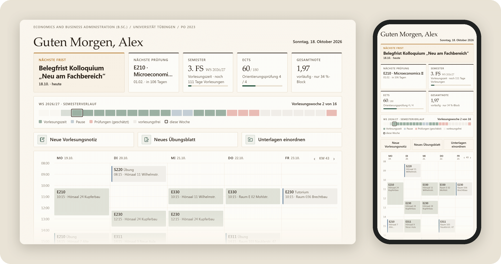
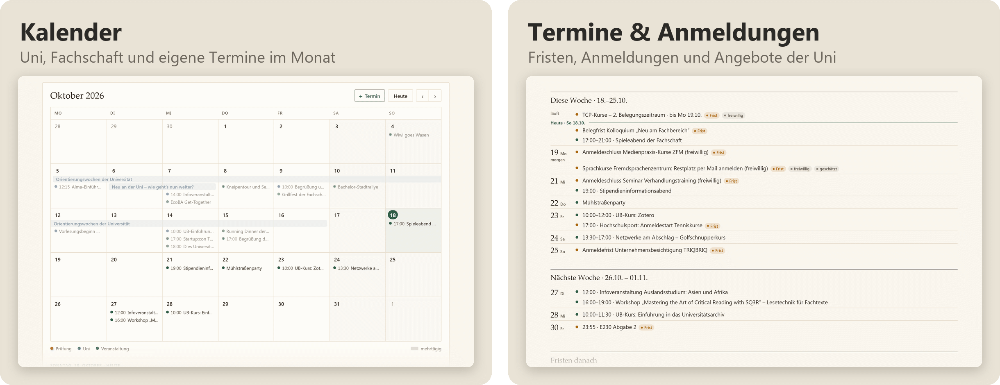
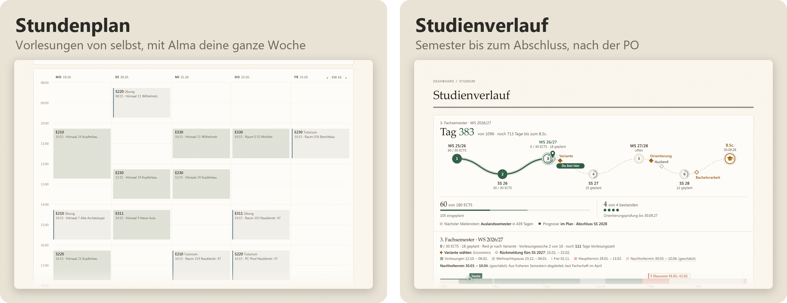
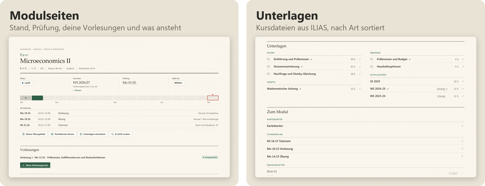
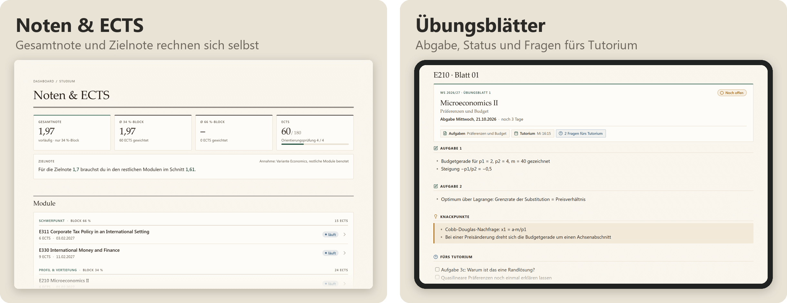
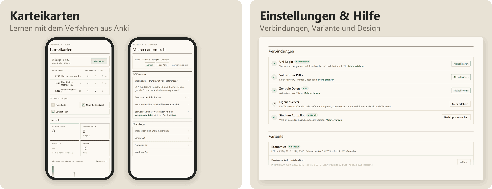
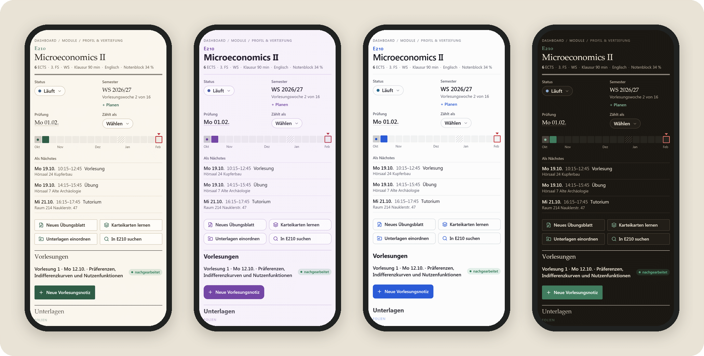

<div align="center">

# Studium Autopilot – EcoBA

**Dein EcoBA-Studium an der Uni Tübingen an einem Ort.**<br>
Termine, Fristen und Stundenplan, die sich selbst aktualisieren, Module, Noten und ECTS, Unterlagen und Karteikarten –
in der kostenlosen App Obsidian, auf iPhone, iPad, Android, Mac und Windows.

<a href="https://github.com/studium-autopilot/ecoba/releases/latest"></a>
<a href="https://github.com/studium-autopilot/ecoba/actions/workflows/pruefen.yml"></a>
<a href="LICENSE"></a>


<sub>🇬🇧 <a href="#in-english">English summary</a></sub>

<br>



Für Studierende im B.Sc. Economics and Business Administration (PO 2023). Kein Konto, keine Kosten, keine Werbung.

</div>

<div align="center">

## In 3 Schritten starten

<br>

<br>
<b>Obsidian installieren</b>

<a href="https://apps.apple.com/app/obsidian-connected-notes/id1557175442"></a>&nbsp;&nbsp;<a href="https://play.google.com/store/apps/details?id=md.obsidian"></a>&nbsp;&nbsp;<a href="https://obsidian.md/download"></a>

<sub>iPhone und iPad: Obsidian öffnen → <b>iCloud verwenden</b> → <b>Vault erstellen</b> (Name egal). Erst dann gibt es den Ordner, in den die Vorlage kommt.<br>Am Mac: <b>Herunterladen für Windows & Mac</b>. Im App Store gibt es Obsidian nur für iPhone und iPad.</sub>

<br>

<br>
<b>Vorlage laden</b>

<a href="https://github.com/studium-autopilot/ecoba/raw/main/docs/kurzbefehl/Studium%20Autopilot%20installieren.shortcut"></a>&nbsp;&nbsp;<a href="https://github.com/studium-autopilot/ecoba/releases/latest/download/Studium-Autopilot.zip"></a>

<sub>Mac und iPhone oder iPad? Erst mit dem Kurzbefehl aufs iPhone oder iPad, dann am Mac aus iCloud öffnen: <a href="docs/installation.md#mac-mit-iphone-oder-ipad">Anleitung</a>.</sub>

<br>

<br>
<b>In Obsidian öffnen</b>

iPhone und iPad: Der Kurzbefehl öffnet <b>Studium Autopilot</b> in Obsidian → <b>Dem Ersteller vertrauen und Erweiterungen aktivieren</b>.<br>Am Computer und unter Android: <b>Ordner als Vault öffnen</b> → Ordner <b>Studium-Autopilot</b> → <b>Dem Ersteller vertrauen und Erweiterungen aktivieren</b>. Fertig.

<br>

Eine kurze Einrichtung fragt nach Studienbeginn und Variante, jeder Schritt lässt sich überspringen.<br>
Mehrere Geräte? → [Weiteres Gerät verbinden](docs/installation.md#weiteres-gerät-verbinden) · Hängt es irgendwo? → [Hilfe zur Installation](#hilfe-zur-installation)

</div>

## Was drin ist












<p align="center"><b>Postfach:</b> deine Uni-Mails direkt in Obsidian, mit demselben Uni-Login</p>



<p align="center"><b>Verschiedene Designs, hell und dunkel</b></p>

## Woher die Daten kommen

Termine, Fristen und Semesterdaten pflegt nicht jede:r selbst. Ein Server prüft regelmäßig öffentliche Quellen der Uni
(Seiten der Universität, des Prüfungsamts und der Fachschaft, das öffentliche Vorlesungsverzeichnis, öffentliche Kalender und PDFs) auf Änderungen. Nur wenn sich
etwas geändert hat, gleicht eine KI die Angaben ab. Vor dem Veröffentlichen wird jeder geänderte Eintrag automatisch geprüft:

- **Freigabeliste:** Nur bestimmte Arten von Terminen aus öffentlichen Quellen und nur bestimmte Felder gehen raus, nie Notiztexte.
- **Scan auf persönliche Daten:** Namen, Mailadressen, Telefonnummern und Ähnliches halten einen Eintrag zurück.
- **KI-Prüfung:** Ein zweiter, getrennter KI-Aufruf prüft geänderte Einträge auf persönliche Angaben und Plausibilität.

Nur was alle Prüfungen besteht, landet als einfache Datendatei im öffentlichen Repo
[`studium-autopilot/ecoba-daten`](https://github.com/studium-autopilot/ecoba-daten). Das Plugin im Tresor holt sie dort ab,
prüft sie noch einmal und legt daraus Termin- und Stundenplan-Notizen an.

Die KI kann sich irren. Darum steht an jedem Termin die Quelle und das Datum der letzten Prüfung; Angaben, die die Uni noch
nicht veröffentlicht hat, sind als **geschätzt** markiert. Der Code des Abgleichs ist nicht Teil dieses Repos. Das
Datenformat steht in [docs/daten-v1.md](docs/daten-v1.md).

## Zusammenfassen mit Claude (freiwillig)

Bei jeder Unterlage füllt **Zusammenfassen** die Abschnitte „Das Wichtigste“, „Zu tun“ und „Offene Fragen“, mit Seitenangaben,
die in die PDF springen. Dafür verbindest du Claude mit einem eigenen API-Schlüssel aus der
[Claude Console](https://platform.claude.com/settings/keys): unter **Einstellungen & Hilfe** → **Verbindungen** → Claude. Das geht
auf jedem Gerät, auch auf iPhone und iPad, ohne Server.

- **Kostet:** meist 0,05 bis 0,50 $ je Zusammenfassung von deinem Guthaben bei Anthropic; bei dicken Unterlagen fragt Obsidian
  vorher. Studium Autopilot bekommt nichts davon.
- **Kein Abo:** Claude Pro oder Max geht dafür nicht, Anthropic erlaubt Abos nur in Claude selbst.
- **Deine Daten:** Nur die Unterlage, die du zusammenfassen lässt, geht an Anthropic. Mehr in
  [docs/datenschutz.md](docs/datenschutz.md#claude-mit-eigenem-api-schlüssel).

## Für Technische: eigener Server mit Claude

Wer mehr will als die Termine für alle, lässt sich einen eigenen, kostenlosen Server einrichten. Darauf sucht Claude mit deinem
eigenen Abo in deinen Uni-Mails und in Gmail nach Terminen, Fristen und Hinweisen, die nur dich betreffen.
Obsidian holt die Ergebnisse verschlüsselt ab und legt sie unter **Termine** an, ohne Doppel zu den Terminen für alle.

- **Kostet nichts:** ein Server im Always-Free-Angebot von Oracle (2 OCPU, 12 GB), ohne Upgrade auf Pay-As-You-Go. Ein Budget
  warnt ab dem ersten Cent, eine Quota sperrt alles, was Geld kosten könnte.
- **Claude richtet ihn ein:** In Claude Desktop führt ein Skill durch alle Schritte und klickt auf Wunsch selbst (Computer
  Use). Anmeldungen, Kreditkarte und Zustimmungen machst du. Hat Oracle gerade keinen Platz, sucht ein kleiner Helfer weiter
  und schickt dir eine Mail, sobald der Server da ist.
- **Du brauchst:** Claude Pro oder Max und ein Oracle-Konto. Gmail ist freiwillig.
- **Deine Daten** bleiben auf deinem Server und in deinem Tresor, der Weg dazwischen ist verschlüsselt. Mehr in
  [docs/datenschutz.md](docs/datenschutz.md#eigener-server-mit-claude).

In Claude Desktop einfügen:

```
Richte mir den eigenen Server für Studium Autopilot ein oder setz die Einrichtung fort (github.com/studium-autopilot/ecoba).
Öffne dazu https://github.com/studium-autopilot/ecoba/releases/latest, nimm die Versionsnummer daraus (vX.Y.Z) und lies aus
genau dieser Version https://github.com/studium-autopilot/ecoba/blob/vX.Y.Z/server/skill/server-einrichten/SKILL.md und die
Dateien daneben. Steht in diesem Chat schon eine ältere Anleitung, gilt nur diese. Führe mich Schritt für Schritt.
```

Wie es gebaut ist: [server/README.md](server/README.md).

## Datenschutz: Was das Plugin tut und nicht tut

Der Tresor bringt ein eigenes kleines Plugin mit („Studium Autopilot“). Du musst nichts weiter installieren.

- **Lädt von selbst nur Daten, nie Code.** Eine neue Version kommt nur, wenn du auf **Neue Version installieren** tippst – direkt aus
  diesem Repo, jede Datei mit Prüfsumme geprüft, vorher mit Sicherung. Deine Einträge bleiben.
- **Kein Konto, keine Statistik, keine Telemetrie.** Nichts über dich geht an den Autor oder an Dritte. GitHub sieht beim
  Abruf deine IP-Adresse, wie bei jeder Webseite.
- **Uni-Login nur, wenn du ihn eingibst.** Dann meldet sich das Plugin von deinem Gerät aus bei der Uni an (ILIAS und Alma)
  und lädt deine Kursdateien, Abgaben und deinen Stundenplan, nur von den Servern der Uni. Das Passwort liegt verschlüsselt im
  Schlüsselbund von Obsidian auf diesem Gerät und wird nie synchronisiert.
- **Dein Postfach nur, wenn du es einschaltest.** Dann zeigt die Seite **Postfach** deinen Uni-Posteingang direkt aus dem
  Webmail der Uni. Deine Mails stehen nur im Speicher des Geräts, nie im Tresor.
- **Deine Kalender-Links (Alma, ILIAS) bleiben auf dem Gerät.** Sie werden nicht synchronisiert und nirgends hin geschickt.
- **Claude nur, wenn du es verbindest.** Dann geht eine Unterlage, wenn du bei ihr auf **Zusammenfassen** tippst, mit deinem
  eigenen Schlüssel direkt an Anthropic. Der Schlüssel bleibt im Schlüsselbund von Obsidian auf diesem Gerät.
- **Deine Einträge bleiben deine.** Häkchen und „Meine Notizen“ in einem Termin überschreibt der Abruf nie, Noten und
  Status deiner Module bleiben auch bei einem Update.

Mehr dazu: [docs/datenschutz.md](docs/datenschutz.md).

## Hinweis

**Kein offizielles Angebot der Universität Tübingen. Keine Gewähr – maßgeblich sind Alma, Prüfungsamt und
Prüfungsordnung.** Studium Autopilot ist eine Beta und wird laufend erweitert; neue Versionen kommen mit einem Tipp auf
**Neue Version installieren**.

Der Tresor enthält keine Lehrmaterialien (Folien, Skripte, Altklausuren); Dateien aus ILIAS lädt das Plugin nur für dich in
deinen eigenen Tresor. Modul- und Prüfungsordnungs-Angaben sind in eigenen Worten zusammengefasst und auf die öffentlichen
Dokumente der Universität verlinkt. Die Bilder zeigen einen Beispiel-Tresor mit erfundenem Namen, Noten, Stundenplan und
Unterlagen.

Apple und App Store sind Marken der Apple Inc. Google Play und das Google Play-Logo sind Marken der Google LLC.

## Fehler melden

Termin falsch, Frist fehlt oder etwas sieht kaputt aus? Bitte ein
[Issue](https://github.com/studium-autopilot/ecoba/issues/new/choose) öffnen – es gibt Vorlagen für Fehler, Termine und
Ideen. Sicherheitslücken bitte privat melden: [SECURITY.md](SECURITY.md). Änderungen je Version:
[CHANGELOG.md](CHANGELOG.md), alle Versionen: [Releases](https://github.com/studium-autopilot/ecoba/releases).

## Hilfe zur Installation

<details>
<summary><b>Hilfe für iPhone & iPad</b></summary>

1. **Obsidian** öffnen → **iCloud verwenden** → einen Namen eingeben (egal welchen, z. B. „Start“) → **Vault erstellen**. Erst damit legt Obsidian den Ordner **iCloud Drive → Obsidian** an; nur öffnen reicht nicht. Ohne iCloud: einen Vault auf dem Gerät erstellen.
2. [**Kurzbefehl für iPhone & iPad**](https://github.com/studium-autopilot/ecoba/raw/main/docs/kurzbefehl/Studium%20Autopilot%20installieren.shortcut) antippen → **Laden** → Datei öffnen → **Kurzbefehl hinzufügen**.
3. Den Kurzbefehl starten → **Erlauben** → als Ort **iCloud Drive → Obsidian** wählen (kein iCloud: **Auf meinem iPhone → Obsidian**), nicht den Ordner des Vaults aus Schritt 1.
4. Obsidian öffnet sich mit **Studium Autopilot** (sonst: **Vault wechseln** → **Studium Autopilot**) → **Dem Ersteller vertrauen und Erweiterungen aktivieren**. Den Vault aus Schritt 1 brauchst du nicht mehr; löschen kannst du ihn in **Dateien** unter **iCloud Drive → Obsidian**.

Klappt der Kurzbefehl nicht: [ZIP-Datei](https://github.com/studium-autopilot/ecoba/releases/latest/download/Studium-Autopilot.zip) laden, in **Dateien** antippen und den Ordner nach **iCloud Drive → Obsidian** (kein iCloud: **Auf meinem iPhone → Obsidian**) bewegen. Fehlt dort der Ordner **Obsidian**: zuerst Schritt 1.

</details>

<details>
<summary><b>Hilfe für Mac</b></summary>

Obsidian für den Mac kommt von [obsidian.md](https://obsidian.md/download), nicht aus dem App Store: Datei öffnen, **Obsidian** in **Programme** ziehen.

**Mit iPhone oder iPad:** zuerst dort installieren (Ort **iCloud Drive → Obsidian**), dann am Mac:

1. Obsidian öffnen → bei **Ordner als Vault öffnen** auf **Öffnen** klicken.
2. **iCloud Drive** → **Obsidian** → `Studium Autopilot` markieren → **Öffnen**.
3. **Dem Ersteller vertrauen und Erweiterungen aktivieren**.

**Nur Mac:**

1. [ZIP-Datei](https://github.com/studium-autopilot/ecoba/releases/latest/download/Studium-Autopilot.zip) laden. Safari packt sie selbst aus, sonst in **Downloads** doppelklicken.
2. Den Ordner `Studium-Autopilot` im Finder von **Downloads** nach **Dokumente** ziehen.
3. Obsidian öffnen → bei **Ordner als Vault öffnen** auf **Öffnen** klicken → **Dokumente** → `Studium-Autopilot` markieren → **Öffnen**.
4. **Dem Ersteller vertrauen und Erweiterungen aktivieren**.

Hängt es? [Hilfe für den Mac](docs/installation.md#hängt-es-am-mac)

</details>

<details>
<summary><b>Hilfe für Windows</b></summary>

1. [ZIP-Datei](https://github.com/studium-autopilot/ecoba/releases/latest/download/Studium-Autopilot.zip) laden, in **Downloads** rechts anklicken → **Alle extrahieren…** → **Extrahieren** (Ziel so lassen).
2. Den Ordner `Studium-Autopilot` aus **Downloads** nach **Dokumente** ziehen.
3. Obsidian öffnen → **Ordner als Vault öffnen** → **Dokumente** → `Studium-Autopilot` → **Ordner auswählen**.
4. **Dem Ersteller vertrauen und Erweiterungen aktivieren**.

</details>

<details>
<summary><b>Hilfe für Android</b></summary>

1. [ZIP-Datei](https://github.com/studium-autopilot/ecoba/releases/latest/download/Studium-Autopilot.zip) laden, in **Dateien** antippen → **Entpacken**.
2. Obsidian öffnen → **Ordner als Vault öffnen** → **Download** → `Studium-Autopilot` → **Diesen Ordner verwenden** → Zugriff **Erlauben**.
3. **Dem Ersteller vertrauen und Erweiterungen aktivieren**.

</details>

**Dashboard bleibt leer, oben steht „Studium Autopilot ist noch aus“?** Beim Vertrauen den anderen Knopf erwischt: **Einstellungen** → **Externe Erweiterungen** → **Eingeschränkten Modus verlassen**. **Fast leerer Tresor mit nur einem Ordner darin?** Den Ordner wählen, in dem `Dashboard.md` direkt liegt.

Die ganze Anleitung mit Alma, ILIAS, weiteren Geräten und Updates: [docs/installation.md](docs/installation.md).

## Wie es gebaut ist

Für alle, die den Code lesen oder mitarbeiten wollen.

- **Plugin ohne Build-Schritt:** Ein kleiner, handgeschriebener Kern (`main.js`) lädt die Skripte aus `System/Skripte/` im
  Tresor und lädt sie bei jeder Änderung neu. Tabellen sind Obsidian Bases, das Aussehen sind CSS-Snippets.
- **Läuft auf iPhone und iPad:** keine Node-APIs in Skripten, eigene Regeln für Skript-Autoren, eine Prüfung gegen Safari 16.
- **Zentrale Daten mit Vertrag:** versioniertes JSON mit Prüfsummen; das Plugin prüft jede Datei, bevor es etwas schreibt.
- **Update mit einem Tipp:** Update-Liste mit SHA-256 je Datei, geladen vom unveränderlichen Tag der Version, vorher eine
  Sicherung.
- **ILIAS direkt vom Gerät:** Anmeldung über das Single Sign-on der Uni, Seiten lesen nach dem Vorbild von PFERD.
- **Geprüft bei jedem Push:** Node-Tests ohne Obsidian, ESLint, Ruff und ein Datenschutz-Scan in GitHub Actions.

```
npm ci
npm test          # Tests ohne Obsidian (Node 22 oder neuer)
npm run lint      # ESLint
npm run pruefen   # Dateitypen, Datenschutz-Scan, Regeln für iPhone und iPad
```

Mehr: [Architektur](docs/architektur.md) · [Datenformat](docs/daten-v1.md) · [Design](docs/design.md) ·
[Tests](docs/tests.md) · [Mithelfen](CONTRIBUTING.md) · [Sicherheit](SECURITY.md)

## In English

Studium Autopilot is a ready-to-use [Obsidian](https://obsidian.md) vault for students of the B.Sc. Economics and Business
Administration (PO 2023) at the University of Tübingen: dashboard, study progress, module pages, grades and ECTS, a
timetable that fills itself from the public course catalogue (or from Alma with your university login), exercise deadlines
and course files from ILIAS, your university inbox, exercise sheets and flashcards with Anki-style scheduling, in several designs,
light and dark. Dates and deadlines keep themselves up to date: a server regularly checks public university sources,
lets an AI reconcile only what changed, checks every entry automatically (allowlist, scan for personal data, AI
review) and publishes the result as plain JSON on GitHub Pages. The bundled plugin fetches only that data, never code, and
sends nothing back. Only if you enter your university login does it sign in from your device (ILIAS, Alma) and download your own course files, deadlines and timetable,
contacting nothing but the university's servers; the password stays in Obsidian's keychain on that device and is never
synced. The same login shows your university inbox on the Postfach page, read straight from the university webmail, but only
after you turn it on; mails stay in memory and are never written to the vault. A new version is installed only when you tap “Neue Version installieren”, straight from this repo, with every file checked
against a SHA-256 list. [Download the latest version](https://github.com/studium-autopilot/ecoba/releases/latest/download/Studium-Autopilot.zip).
Architecture notes: [docs/architektur.md](docs/architektur.md), data contract: [docs/daten-v1.md](docs/daten-v1.md).

## Lizenz

- Code (Plugin, Skripte, Design): [MIT](LICENSE)
- Eigene Inhalte, Texte und Daten: [CC BY 4.0](LICENSE-INHALTE.md)
- Fremder Code (ILIAS-Anmeldung und Seiten lesen nach [PFERD](https://github.com/Garmelon/PFERD), MIT):
  [THIRD_PARTY_NOTICES.md](THIRD_PARTY_NOTICES.md)

## Autor

Philip Walter ([@pdotwalt](https://github.com/pdotwalt)), Student im B.Sc. Economics and Business Administration in Tübingen.
