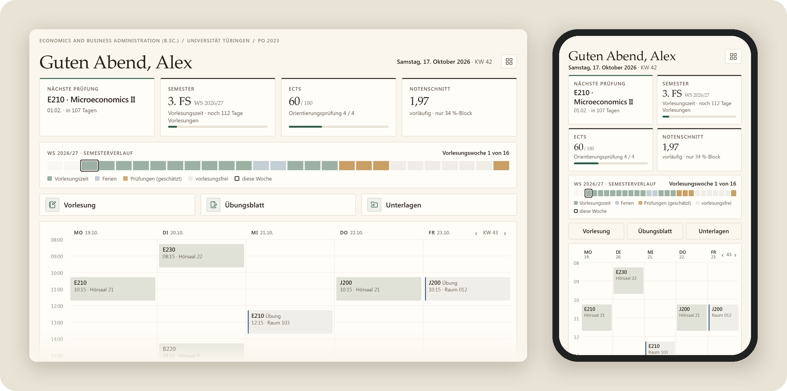
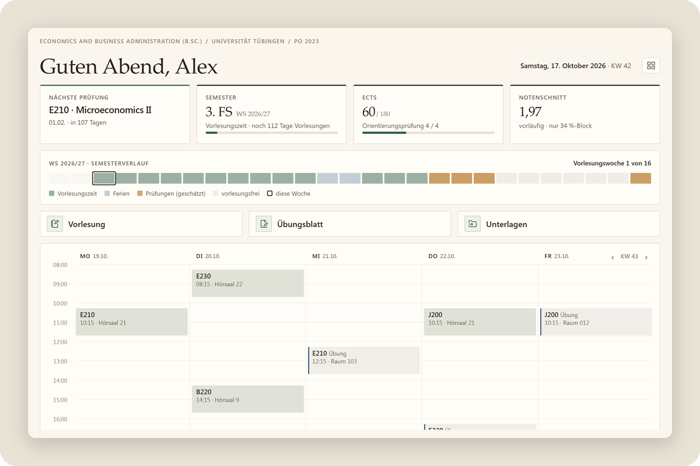
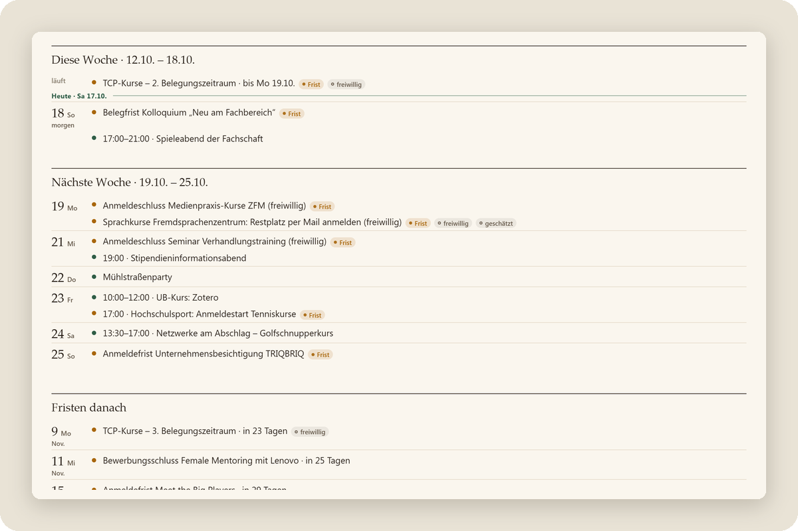
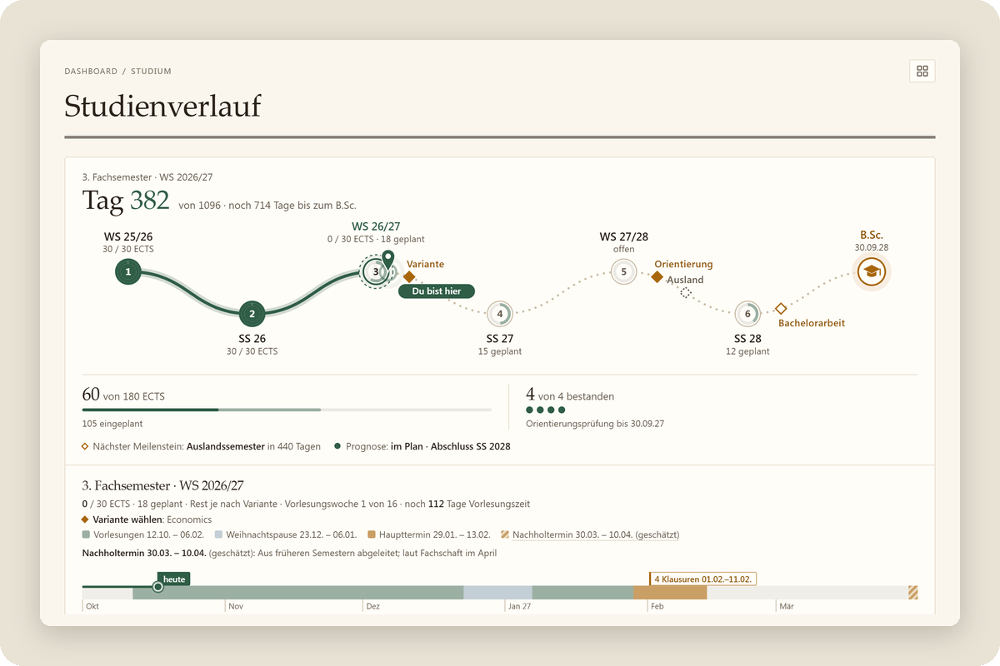
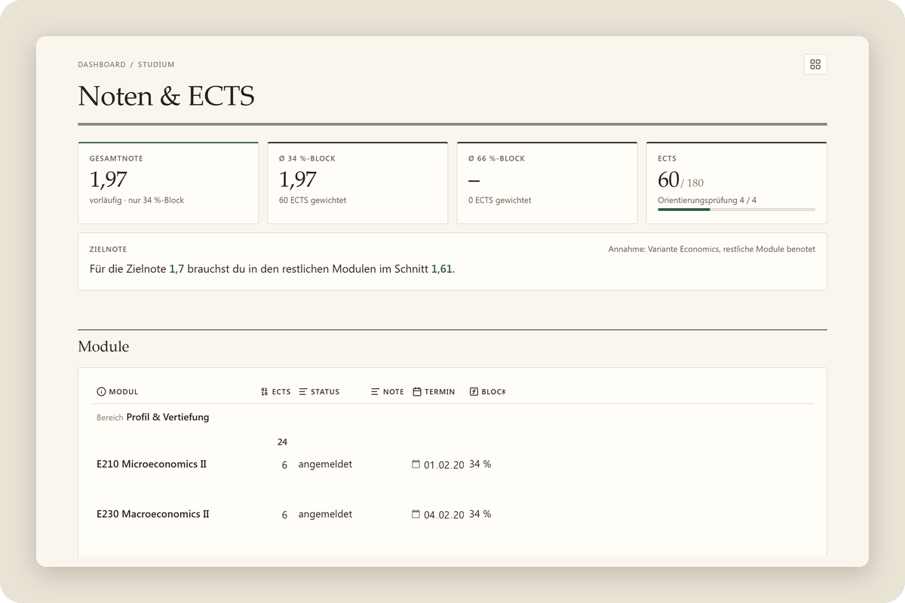
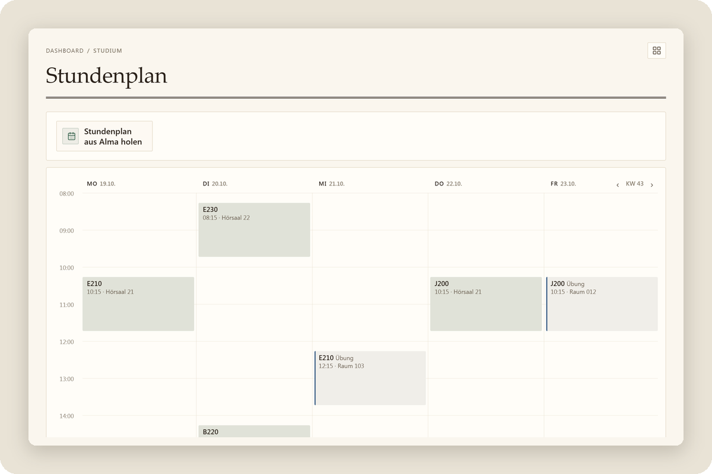
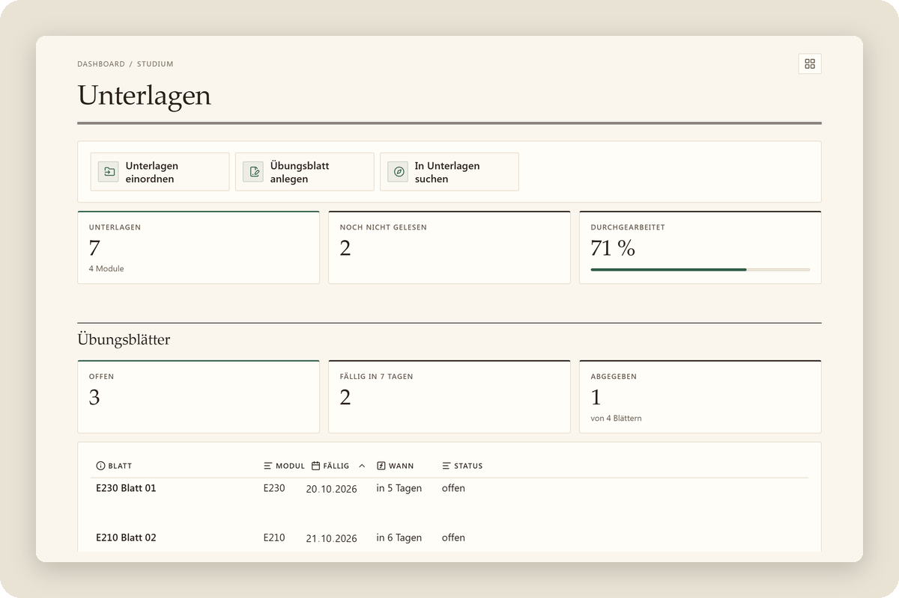

&nbsp; Noch im Aufbau – noch nicht dabei: Abgabefristen aus ILIAS, KI-Assistent für Mails, Einrichtung mit Claude Code

# Studium Autopilot – EcoBA

**Dein EcoBA-Studium an der Uni Tübingen an einem Ort.** 
Termine und Fristen, die sich selbst aktualisieren, Studienplan, Noten und ECTS – in der kostenlosen App Obsidian, auf
Handy, Tablet und Computer. 
🇬🇧 <a href="#in-english">English summary</a>

 

## In 3 Schritten starten

 

 
<b>Obsidian installieren</b>

&nbsp;&nbsp;&nbsp;&nbsp;

 

 
<b>Vorlage laden</b>

&nbsp;&nbsp;

 

 
<b>In Obsidian öffnen</b>

Ordner <b>Studium Autopilot</b> als Tresor öffnen → <b>Vertrauen und Plugins aktivieren</b>. Fertig.

 

Das richtet die Vorlage auf einem Gerät ein. Mehrere Geräte? → [Weiteres Gerät verbinden](docs/installation.md#weiteres-gerät-verbinden)

Hängt es irgendwo? → [Hilfe zur Installation](#hilfe-zur-installation)

## Was drin ist

<table>
<tr>
<td width="50%" align="center" valign="top"> <b>Dashboard</b> Nächste Prüfung, Semester, ECTS und Notenschnitt auf einen Blick</td>
<td width="50%" align="center" valign="top"> <b>Termine & Anmeldungen</b> Woche für Woche mit Fristen, Anmeldungen und Angeboten der Uni</td>
</tr>
<tr>
<td width="50%" align="center" valign="top"> <b>Studienverlauf</b> Semester bis zum Abschluss, Orientierungsprüfung, Schwerpunkte nach den Regeln der PO</td>
<td width="50%" align="center" valign="top"> <b>Module & Noten</b> 86 Module nach PO 2023, Gesamtnote und ECTS rechnen sich selbst</td>
</tr>
<tr>
<td width="50%" align="center" valign="top"> <b>Stundenplan</b> Deine Woche aus Alma, mit ‹ › durch alle Kalenderwochen</td>
<td width="50%" align="center" valign="top"> <b>Unterlagen</b> Vorlesungsnotizen mit einem Klick, Kursdateien aus ILIAS je Modul</td>
</tr>
</table>

## Woher die Daten kommen

Termine, Fristen und Semesterdaten pflegt nicht jede:r selbst. Ein Server führt stündlich einen KI-gestützten Abgleich öffentlicher Uni-Quellen aus (Seiten der Universität, des Prüfungsamts und der Fachschaft, öffentliche Kalender und PDFs). Vor dem Veröffentlichen wird jeder geänderte Eintrag automatisch geprüft:

- **Freigabeliste:** Nur bestimmte Arten von Terminen aus öffentlichen Quellen und nur bestimmte Felder gehen raus, nie Notiztexte.
- **Scan auf persönliche Daten:** Namen, Mailadressen, Telefonnummern und Ähnliches halten einen Eintrag zurück.
- **KI-Prüfung:** Ein zweiter, getrennter KI-Aufruf prüft geänderte Einträge auf persönliche Angaben und Plausibilität. Nur was alle Prüfungen besteht, wird veröffentlicht.

Was die Prüfung besteht, landet als einfache Datendatei im öffentlichen Repo [`studium-autopilot/ecoba-daten`](https://github.com/studium-autopilot/ecoba-daten). Das Plugin im Tresor holt sie dort ab, prüft sie noch einmal und legt daraus Termin-Notizen an.

Die KI kann sich irren. Darum steht an jedem Termin die Quelle und das Datum der letzten Prüfung; Angaben, die die Uni noch nicht veröffentlicht hat, sind als **geschätzt** markiert. Der Code des Abgleichs ist nicht Teil dieses Repos. Das Datenformat steht in [docs/daten-v1.md](docs/daten-v1.md).

## Was das Plugin tut und nicht tut

Der Tresor bringt ein eigenes kleines Plugin mit („Studium Autopilot“). Du musst nichts weiter installieren.

- **Lädt von selbst nur Daten, nie Code.** Eine neue Version der Vorlage kommt nur, wenn du auf **Aktualisieren** tippst –
  direkt aus diesem Repo, jede Datei mit Prüfsumme geprüft, vorher mit Sicherung. Deine Einträge bleiben.
- **Kein Konto, keine Statistik, keine Telemetrie.** Nichts über dich geht an den Autor oder an Dritte. GitHub sieht beim Abruf deine IP-Adresse, wie bei jeder Webseite.
- **ILIAS nur, wenn du es verbindest.** Dann meldet sich das Plugin von deinem Gerät aus bei der Uni an und lädt deine
  Kursdateien, nur von den Servern der Uni. Das Passwort bleibt verschlüsselt im Schlüsselbund des Geräts und wird nie synchronisiert.
- **Dein Alma-Link bleibt auf dem Gerät.** Er wird nicht synchronisiert und nirgends hin geschickt.
- Deine Häkchen und alles unter „Meine Notizen“ in einem Termin werden nie überschrieben.

Mehr dazu: [docs/datenschutz.md](docs/datenschutz.md).

## Hinweis

**Kein offizielles Angebot der Universität Tübingen. Keine Gewähr – maßgeblich sind Alma, Prüfungsamt und Prüfungsordnung.**

Der Tresor enthält keine Lehrmaterialien (Folien, Skripte, Altklausuren); Dateien aus ILIAS lädt das Plugin nur für dich in deinen eigenen Tresor. Modul- und Prüfungsordnungs-Angaben sind in eigenen Worten zusammengefasst und auf die öffentlichen Dokumente der Universität verlinkt.

Apple und App Store sind Marken der Apple Inc. Google Play und das Google Play-Logo sind Marken der Google LLC.

## Fehler melden

Termin falsch, Frist fehlt oder etwas sieht kaputt aus? Bitte ein [Issue](https://github.com/studium-autopilot/ecoba/issues/new/choose) öffnen – es gibt Vorlagen für Fehler, Termine und Ideen. Wie du mithelfen kannst: [CONTRIBUTING.md](CONTRIBUTING.md). Änderungen je Version: [CHANGELOG.md](CHANGELOG.md). Alle Versionen: [Releases](https://github.com/studium-autopilot/ecoba/releases).

## Hilfe zur Installation

<b>Hilfe für iPhone & iPad</b>

1. **Obsidian** einmal öffnen und wieder schließen.
2. [**Kurzbefehl für iPhone & iPad**](https://github.com/studium-autopilot/ecoba/raw/main/docs/kurzbefehl/Studium%20Autopilot%20installieren.shortcut) antippen → **Laden** → Datei öffnen → **Kurzbefehl hinzufügen**.
3. Den Kurzbefehl starten → **Erlauben** → als Ort **iCloud Drive → Obsidian** wählen (kein iCloud: **Auf meinem iPhone → Obsidian**).
4. Obsidian öffnen → **Studium Autopilot** → **Vertrauen und Plugins aktivieren**.

Klappt der Kurzbefehl nicht: [ZIP-Datei](https://github.com/studium-autopilot/ecoba/releases/latest/download/Studium-Autopilot.zip) laden, in **Dateien** antippen und den Ordner nach **iCloud Drive → Obsidian** (kein iCloud: **Auf meinem iPhone → Obsidian**) bewegen.

<b>Hilfe für Mac & Windows</b>

1. [ZIP-Datei](https://github.com/studium-autopilot/ecoba/releases/latest/download/Studium-Autopilot.zip) laden und entpacken (Mac: Doppelklick, Windows: Rechtsklick → **Alle extrahieren**).
2. Den Ordner `Studium Autopilot` an einen festen Platz legen, z. B. **Dokumente**.
3. Obsidian öffnen → **Ordner als Tresor öffnen** → den Ordner `Studium Autopilot` wählen.
4. **Vertrauen und Plugins aktivieren**.

<b>Hilfe für Android</b>

1. [ZIP-Datei](https://github.com/studium-autopilot/ecoba/releases/latest/download/Studium-Autopilot.zip) laden, in **Dateien** antippen → **Entpacken**.
2. Obsidian öffnen → **Ordner als Tresor öffnen** → den Ordner `Studium Autopilot` wählen → Zugriff **Erlauben**.
3. **Vertrauen und Plugins aktivieren**.

## Für Fortgeschrittene

- **Weiteres Gerät verbinden:** nur Apple-Geräte über iCloud, sonst Obsidian Sync oder Syncthing – [Anleitung](docs/installation.md#weiteres-gerät-verbinden)
- **Mit Claude-Abo:** alles mit einem Befehl in Claude Code einrichten (kommt bald) – [Mit Claude Code](docs/installation.md#mit-claude-code)

## In English

Studium Autopilot is a ready-to-use [Obsidian](https://obsidian.md) vault for students of the B.Sc. Economics and Business Administration at the University of Tübingen. It combines a module catalogue, study plan, grade tracking and a calendar in one place. Dates and deadlines are kept up to date automatically: a server runs an hourly AI-assisted comparison of public university sources, checks the results automatically (allowlist, scan for personal data, AI review) and publishes them as plain JSON on GitHub Pages. A small Obsidian plugin bundled with the vault fetches only that data, never code, and sends nothing back. Only if you connect your university's ILIAS does it also sign in there from your device and download your own course files, contacting nothing but the university's servers; the password stays in the device's keychain and is never synced. A new version of the vault itself is installed only when the user taps “Update”, straight from this repo, with every file checked against a SHA-256 list. [Download the latest version](https://github.com/studium-autopilot/ecoba/releases/latest/download/Studium-Autopilot.zip). Architecture notes are in [docs/architektur.md](docs/architektur.md) and [docs/daten-v1.md](docs/daten-v1.md).

## Lizenz

- Code (Plugin, Skripte, Design): [MIT](LICENSE)
- Eigene Inhalte, Texte und Daten: [CC BY 4.0](LICENSE-INHALTE.md)
- Fremder Code (ILIAS-Anmeldung und Seiten lesen nach PFERD, MIT): [THIRD_PARTY_NOTICES.md](THIRD_PARTY_NOTICES.md)

## Autor

Philip Walter ([@pdotwalt](https://github.com/pdotwalt)), Student im B.Sc. Economics and Business Administration in Tübingen.
