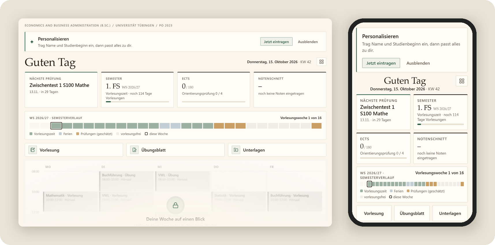
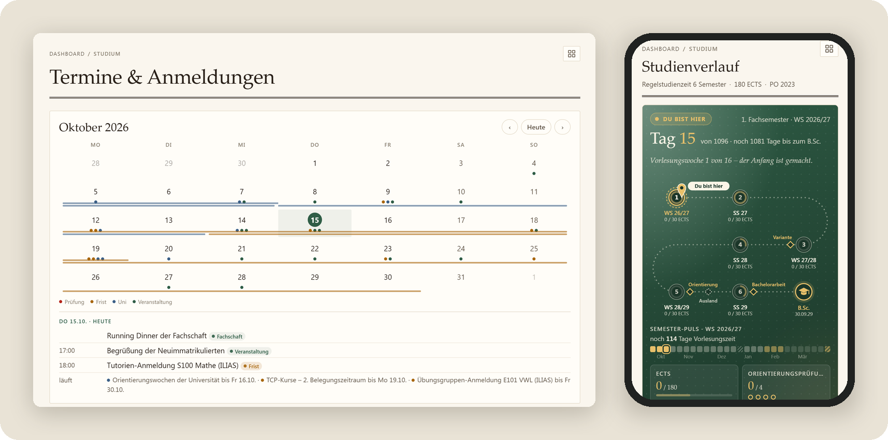
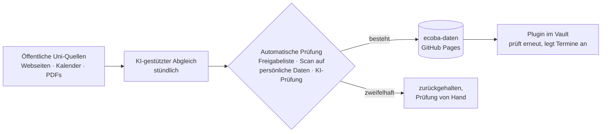

# Studium Autopilot – EcoBA

**Dein EcoBA-Studium an der Uni Tübingen an einem Ort.** 
Termine und Fristen, die sich selbst aktualisieren, Studienplan, Noten und ECTS – in der kostenlosen App Obsidian, auf
Handy, Tablet und Computer.

 

Kostenlos · ohne Konto · für iPhone, iPad, Android, Windows und Mac

 

> [!TIP]
> **Zum ersten Mal auf GitHub?** Du brauchst kein Konto und musst hier nichts verstehen. Der grüne Knopf oben lädt die
> Vorlage herunter, die drei Schritte darunter erklären den Rest.

## In 3 Schritten starten

**1. Obsidian installieren** – kostenlos für
[iPhone und iPad](https://apps.apple.com/app/obsidian-connected-notes/id1557175442),
[Android](https://play.google.com/store/apps/details?id=md.obsidian),
[Windows und Mac](https://obsidian.md/download).

**2. Vorlage herunterladen** – mit dem grünen Knopf oben. Du bekommst eine ZIP-Datei; daraus wird beim Öffnen der Ordner
`Studium Autopilot`.

**3. In Obsidian öffnen** – den Ordner `Studium Autopilot` als Tresor öffnen und auf **Vertrauen und Plugins aktivieren**
tippen. Fertig: Das Dashboard öffnet sich, Termine und Fristen kommen von selbst.

<b>iPhone und iPad</b> – Schritt für Schritt

1. Obsidian einmal öffnen und wieder schließen. Dann gibt es in der Dateien-App den Ordner **Obsidian**.
2. App **Dateien** öffnen → **Downloads** → die ZIP-Datei antippen. Sie wird zu einem Ordner `Studium Autopilot`.
3. Den Ordner gedrückt halten → **Bewegen** → **Auf meinem iPhone** (bzw. **Auf meinem iPad**) → **Obsidian** →
   **Bewegen**.
4. Obsidian öffnen, **Studium Autopilot** antippen und **Vertrauen und Plugins aktivieren** wählen.

<b>Windows und Mac</b> – Schritt für Schritt

1. ZIP-Datei entpacken: Windows: Rechtsklick → **Alle extrahieren**. Mac: Doppelklick (Safari entpackt oft schon selbst).
2. Den Ordner `Studium Autopilot` an einen festen Platz legen, z. B. in **Dokumente**.
3. Obsidian öffnen → **Ordner als Tresor öffnen** → den Ordner `Studium Autopilot` wählen.
4. **Vertrauen und Plugins aktivieren** wählen.

<b>Android</b> – Schritt für Schritt

1. ZIP-Datei in der App **Dateien** (oder deinem Dateimanager) antippen → **Entpacken**.
2. Den Ordner `Studium Autopilot` z. B. nach **Documents** verschieben.
3. Obsidian öffnen → **Ordner als Tresor öffnen** → den Ordner wählen. Falls Obsidian nach Zugriff auf Dateien fragt:
   erlauben.
4. **Vertrauen und Plugins aktivieren** wählen.

Mehrere Geräte, Alma-Stundenplan verbinden, Updates: [ausführliche Anleitung](docs/installation.md).

## Was drin ist

- **Dashboard:** nächste Prüfung, aktuelles Semester, ECTS, Notenschnitt, Fristen der nächsten 30 Tage und deine To-dos.
- **Termine und Fristen, die sich selbst aktualisieren:** Semesterdaten, Prüfungsphasen, Anmeldefristen und
  Veranstaltungen für EcoBA-Studierende kommen etwa stündlich von selbst.
- **Studienverlauf:** Musterstudienplan je Variante (Economics, Business Administration, ohne Spezialisierung),
  Orientierungsprüfung, Meilensteine.
- **Module und Noten:** 86 Module nach PO 2023 plus Mathe-Vorkurs, Gesamtnote und ECTS rechnen sich aus deinen Einträgen,
  dazu ein Schwerpunkt-Planer.
- **Alltag:** Stundenplan aus Alma (optional), Vorlesungsnotizen mit einem Klick, Unterlagen einordnen.

## Woher die Daten kommen

Termine, Fristen und Semesterdaten pflegt nicht jede:r selbst. Ein Server führt stündlich einen KI-gestützten Abgleich öffentlicher Uni-Quellen aus (Seiten der Universität, des Prüfungsamts und der Fachschaft, öffentliche Kalender und PDFs). Vor dem Veröffentlichen wird jeder geänderte Eintrag automatisch geprüft:

- **Freigabeliste:** Nur bestimmte Arten von Terminen aus öffentlichen Quellen und nur bestimmte Felder gehen raus, nie Notiztexte.
- **Scan auf persönliche Daten:** Namen, Mailadressen, Telefonnummern und Ähnliches halten einen Eintrag zurück.
- **KI-Prüfung:** Ein zweiter, getrennter KI-Aufruf prüft geänderte Einträge auf persönliche Angaben und Plausibilität. Zweifelhaftes wird nicht veröffentlicht, sondern von Hand geprüft.

Was die Prüfung besteht, landet als einfache Datendatei im öffentlichen Repo [`studium-autopilot/ecoba-daten`](https://github.com/studium-autopilot/ecoba-daten). Das Plugin im Vault holt sie dort ab, prüft sie noch einmal und legt daraus Termin-Notizen an.

Die KI kann sich irren. Darum steht an jedem Termin die Quelle und das Datum der letzten Prüfung; Angaben, die die Uni noch nicht veröffentlicht hat, sind als **geschätzt** markiert. Der Code des Abgleichs ist nicht Teil dieses Repos. Das Datenformat steht in [docs/daten-v1.md](docs/daten-v1.md).

## Was das Plugin tut und nicht tut

Der Vault bringt ein eigenes kleines Plugin mit („Studium Autopilot“). Du musst nichts weiter installieren.

- **Lädt nur Daten, nie Code.** Neue Versionen der Vorlage lädst du selbst herunter; das Plugin zeigt nur einen Hinweis.
- **Sendet nichts.** Kein Konto, keine Statistik, keine Telemetrie. GitHub sieht beim Abruf deine IP-Adresse, wie bei jeder Webseite.
- **Speichert keine Passwörter**, auch nicht für Alma, ILIAS oder Mail.
- **Dein Alma-Link bleibt auf dem Gerät.** Er wird nicht synchronisiert und nirgends hin geschickt.
- Deine Häkchen und alles unter „Meine Notizen“ in einem Termin werden nie überschrieben.

Mehr dazu: [docs/datenschutz.md](docs/datenschutz.md).

## Hinweis

**Kein offizielles Angebot der Universität Tübingen. Keine Gewähr – maßgeblich sind Alma, Prüfungsamt und Prüfungsordnung.**

Der Vault enthält keine Lehrmaterialien (Folien, Skripte, Altklausuren). Modul- und Prüfungsordnungs-Angaben sind in eigenen Worten zusammengefasst und auf die öffentlichen Dokumente der Universität verlinkt.

## Fehler melden

Termin falsch, Frist fehlt oder etwas sieht kaputt aus? Bitte ein [Issue](https://github.com/studium-autopilot/ecoba/issues/new/choose) öffnen – es gibt Vorlagen für Fehler, Termine und Ideen. Wie du mithelfen kannst: [CONTRIBUTING.md](CONTRIBUTING.md). Änderungen je Version: [CHANGELOG.md](CHANGELOG.md). Alle Versionen: [Releases](https://github.com/studium-autopilot/ecoba/releases).

## In English

Studium Autopilot is a ready-to-use [Obsidian](https://obsidian.md) vault for students of the B.Sc. Economics and Business Administration at the University of Tübingen. It combines a module catalogue, study plan, grade tracking and a calendar in one place. Dates and deadlines are kept up to date automatically: a server runs an hourly AI-assisted comparison of public university sources, checks the results automatically (allowlist, scan for personal data, AI review) and publishes them as plain JSON on GitHub Pages. A small Obsidian plugin bundled with the vault fetches only that data, never code, and sends nothing back. [Download the latest version](https://github.com/studium-autopilot/ecoba/releases/latest/download/Studium-Autopilot.zip). Architecture notes are in [docs/architektur.md](docs/architektur.md) and [docs/daten-v1.md](docs/daten-v1.md).

## Lizenz

- Code (Plugin, Skripte, Design): [MIT](LICENSE)
- Eigene Inhalte, Texte und Daten: [CC BY 4.0](LICENSE-INHALTE.md)

## Autor

Philip Walter ([@pdotwalt](https://github.com/pdotwalt)), Student im B.Sc. Economics and Business Administration in Tübingen.
